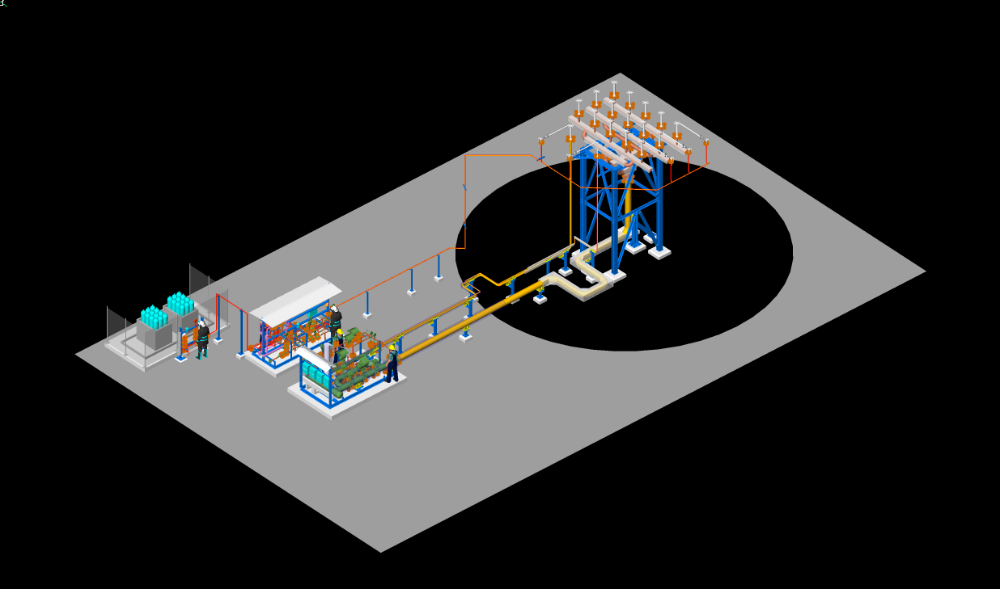
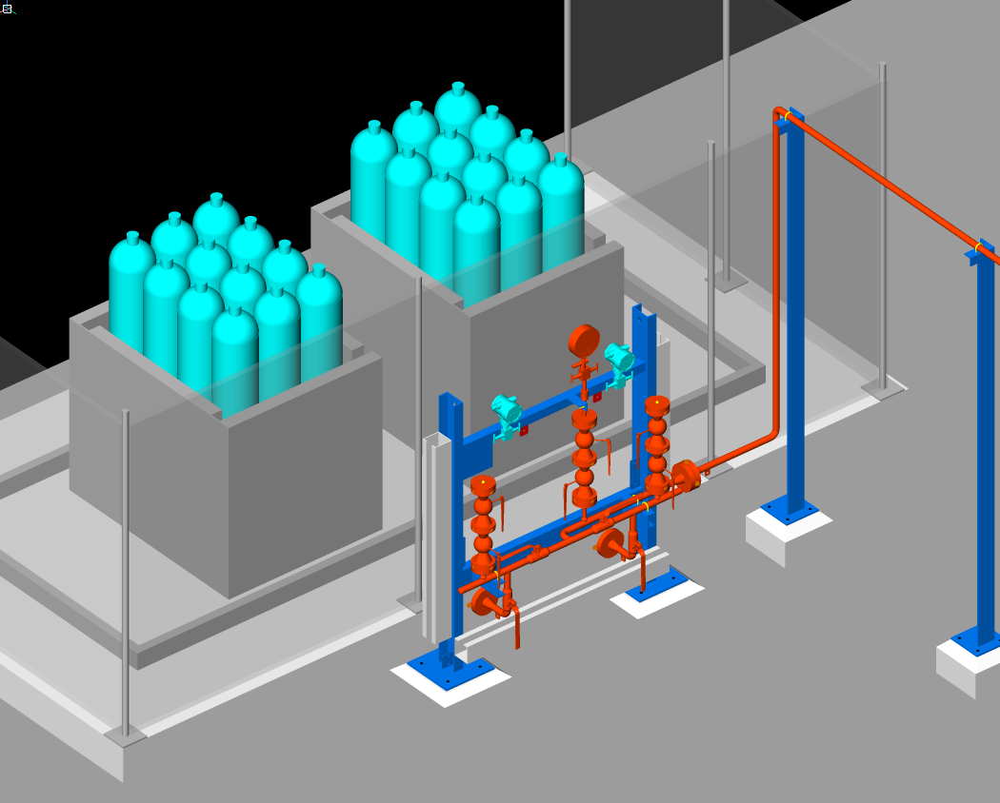
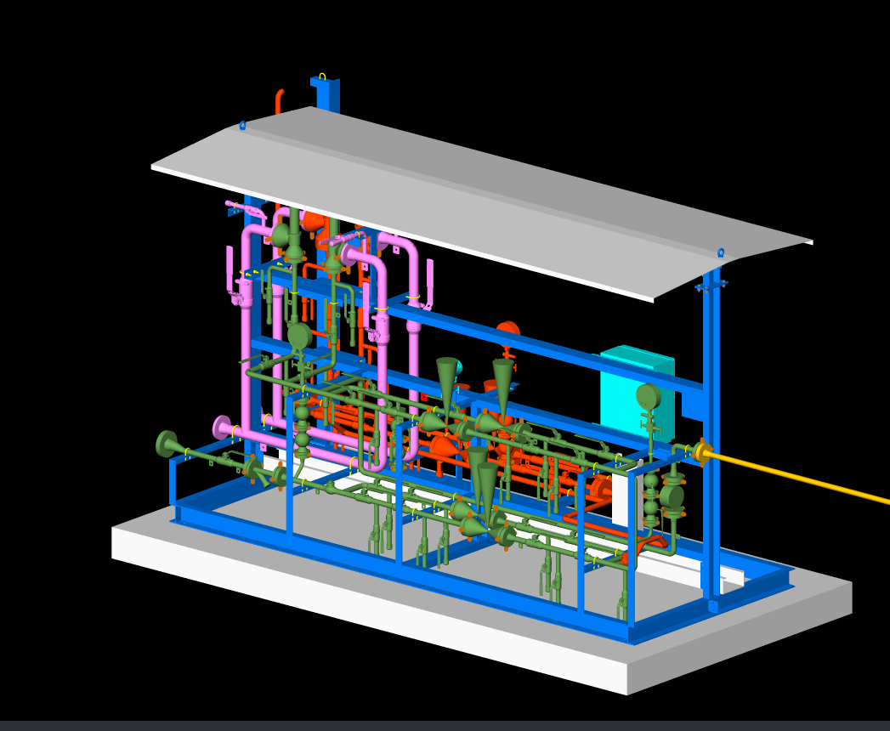
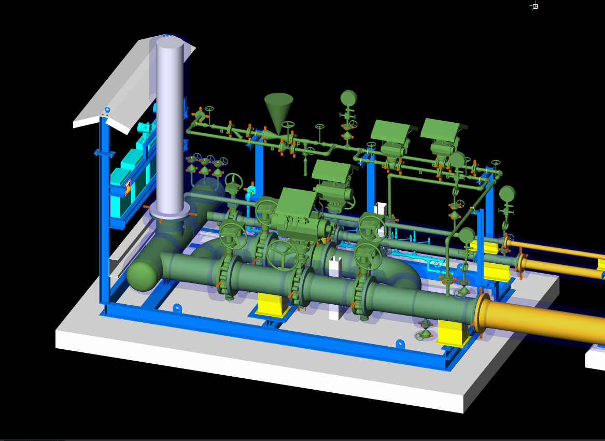
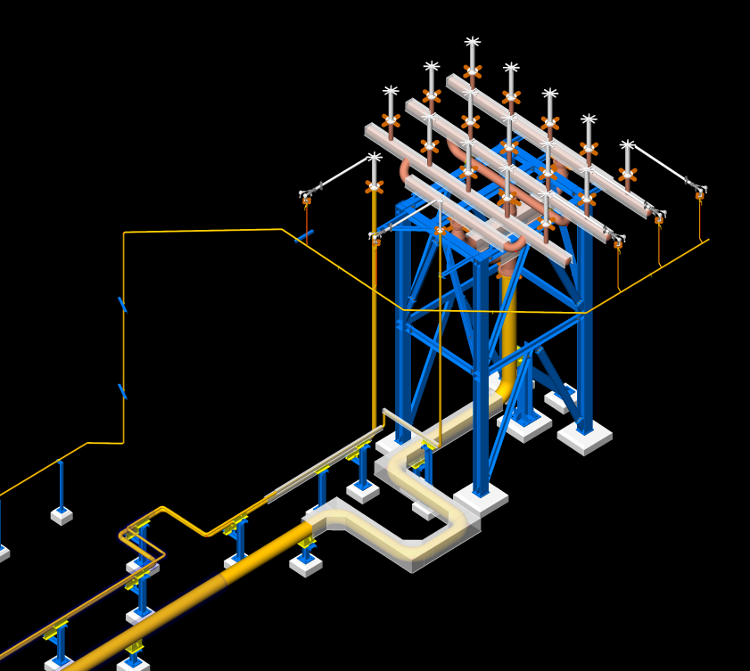

## 1. Project Scope & Facility Scale
This EPC detail-design project covered an enclosed ground flare package for an Italian combustion-systems OEM, installed on a large development project in Saudi Arabia. Our company was responsible for the engineering only. I led the piping side as Project Specific Leader (PSL): besides the piping work itself, I was in charge of everything on the project outside the piping department's own deliverables. The team consisted of me, one drafter, our manager as the final checker and one stress analyst.

The package was made of three skids: a **staging skid**, which receives the flare gas and routes it to the burner stages as the flow increases, an **ignition skid**, which supplies hydrogen pilot gas together with the ignition and flame-monitoring instrumentation, and a **hydrogen supply skid** built around a bottle rack. My scope was the complete piping design of all three skids and the 6" flare header, roughly 30 line numbers with line sizes from ½" to 12".

All piping was designed to ASME B31.3 under a client-specific piping specification with five piping classes, plus a small-bore Class 1500 sub-specification for the high-pressure hydrogen connections. The services ranged from low-pressure flare gas (3.5 barg, up to 280 °C) to hydrogen at roughly 90 barg, together with nitrogen and instrument air at 10 barg. Most lines were carbon steel (A106 Gr.B / API 5L Gr.B pipe, A234 WPB fittings, A105 flanges), while instrument air was in A312 TP316L. The hydrogen classes added NACE and hydrogen-service requirements, a 220 HV10 hardness limit on base metal and welds, and wire-mesh guards on flanges. Components followed ASME B16.5, B16.9, B16.11, B16.36 and B16.48, with B16.20/B16.21 gaskets and API 602/600/608/594/623 valves. The hydrogen classes also required low-emission (ISO 15848-1) and fire-safe (API 607) valves. On top of this, the client issued its own standards for the piping material specification, accessibility, project engineering and the placement of special components such as earth lugs and earth plates on the skids.

## 2. Core Engineering Challenges
The main challenge was data, not geometry. The equipment vendors changed during the project, and every vendor change brought different valves and special items with different dimensions. None of those special items had confirmed dimensions until the sixth month, so the staging and ignition skids went through around five redesign rounds. Tie-in changes, mostly a change in the direction of entry, were much less painful and were absorbed through early coordination in a single redesign each time.

Skids are always tight, and these were no exception. On top of the space limits, the client's accessibility specification fixed the elevations of valve handwheels, which narrowed the usable routing for almost every line. Finally, the schedule itself was distorted: the work was originally supposed to take around three months, but client-side delays stretched it to nine (January to October 2025).

## 3. Problem Solving & Inter-Disciplinary Execution
This was my first project as lead in the company, and I did not build any automation for it. Instead, I put the effort where the risk was:
- **Route Studies for Accessibility:** For the lines affected by the handwheel-elevation requirement, I checked every possible route until I found one that met the client's accessibility specification and still fit the skid. It took many hours, but it avoided late rejections.
- **Standard Layout & Support Sharing:** The same layout strategy and support-sharing practice was applied to all three skids, which kept redesign rounds contained when valve and special-item dimensions changed.
- **Disciplined Manual Control:** Checking, modeling and issuing were done manually and revision by revision, so every vendor change was traced through the model, the isometrics and the supports.
- **Direct Client Support:** Whenever the client faced an issue on site, they called me directly and I gave consultation within the shortest possible time.

## 4. Final 3D Model & Deliverables
The final package included piping plans, general arrangement drawings, MTOs, around 150 sheets of isometrics, support layouts and support details, all produced in ESAIN ESApro 3DP. Our stress analyst issued the stress analysis report, with the staging skid lines being the most critical. The client was very satisfied with the deliverables and with the response time throughout the project.

*(Below are snapshots of the finalized 3D model: the overall package, the hydrogen supply skid, the ignition skid and the staging skid).*

