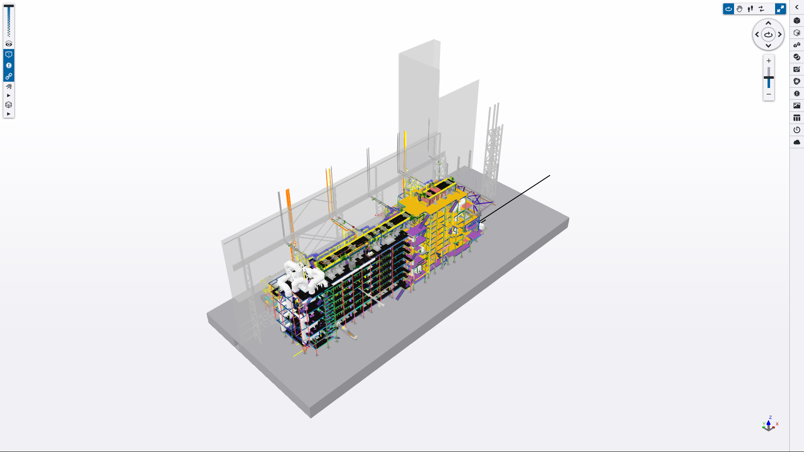
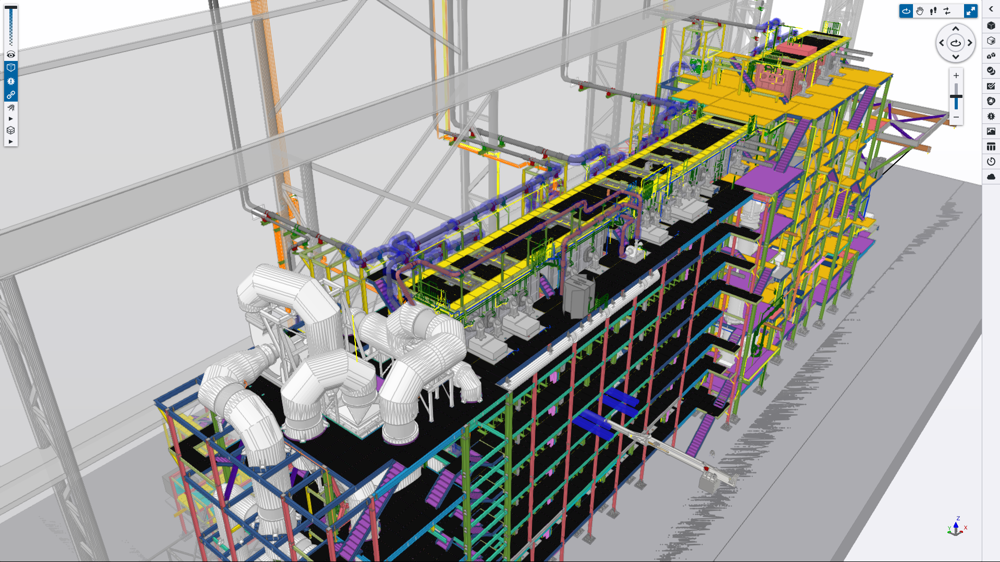
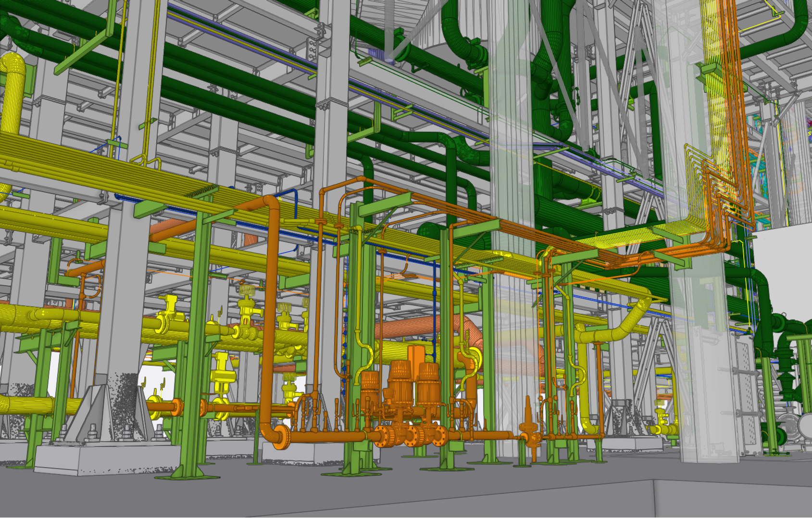
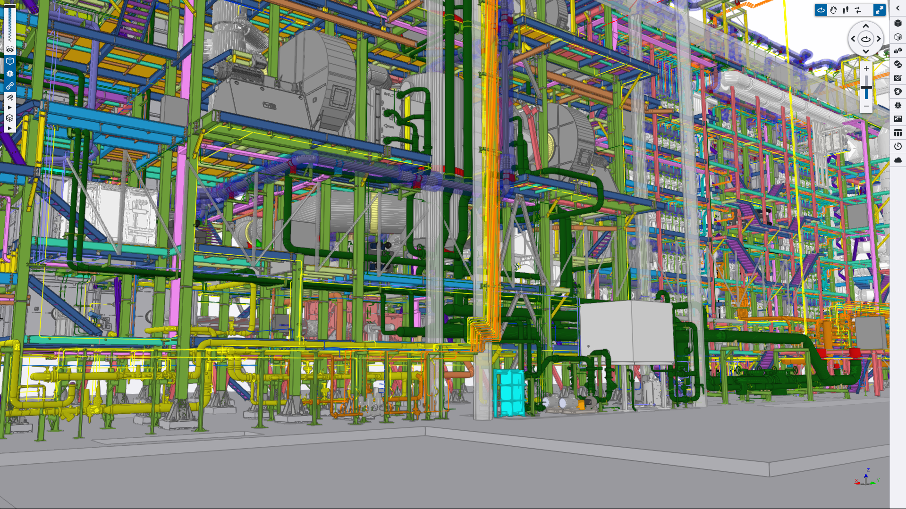

## 1. Project Scope & Facility Scale
The Continuous Galvanizing Line project, engineered for one of the biggest companies in France, involved the comprehensive piping design for a massive galvanized metal roll plant. The facility's extreme thermal and process requirements dictated a highly complex material specification including 10 distinct piping classes along with client-specific design practices and specifications. Materials ranged from standard Carbon Steels (P195, S235JR) to specialized high-temperature Stainless Steels (A240 Gr. 309S/310S, A312 Gr. TP304L/TP309S/TP310S).
The physical scope consisted over 1,500 critical line numbers across 10 service fluids, including Hydrogen and Nitrogen mixing stations, Oxidation and Waste Gas exhausts, Cold Air, Cooling Water, and Demineralized Water systems. All routing and component selections were mandated to strictly comply with European standards alongside client's proprietary burner panel configurations and maintenance clearance specifications.

## 2. Core Engineering Challenges
The project environment was highly volatile, severely constrained by an 8-month delivery schedule, limited piping department manpower, and constantly shifting inter-disciplinary priorities. Because mechanical vendor drawings were frequently delayed, nozzle locations and equipment boundaries were treated as dynamic variables for much of the project.
Furthermore, since most of the used piping components should be compatible with client's own custom piping component standards, out-of-the-box piping components were insufficient. Furthermore, the client mandated us to use a specific Plant Design software called ESAIN ESApro 3DP.
So, not only that we need to learn this software in a very limited time schedule, but also we had to deliver the entire package of 1500 line numbers in a very tight schedule.

## 3. Problem Solving & Inter-Disciplinary Execution
This situation dictated us to use every bit of creativity that we had to cut down required man/hours for every little task. Therefore I had to bypass the limitations of the standard modeling software by engineering independent data pipelines using following interventions:
- **Excel-Driven Catalogue Coordination:** Instead of manually inputting component parameters, I fed the raw material specifications into a custom Excel data model. By syncing this database directly with the 3D model's catalogue, the component creation and checking processes were drastically accelerated.
- **Automated MTO Revision Control:** We assigned client's specific Itemcodes to all components and automated the extraction of raw CSV files from the 3D model. These files were fed into a custom Excel Data Model that automatically calculated material differences across project revisions, completely automating the Material Take-Off (MTO) extraction without manual controling.
- **Isometric Congestion Management:** To resolve severe clashes between dimensions and TAG annotations on the highly congested spools, I strategically mapped custom Break Points within the 3D model. Initially it added around 10% time in the modeling stage, however in the Isometric extraction stage, it drastically reducing 2D sheet congestion and minimizing manual drafting cleanup.

## 4. Final 3D Model & Deliverables
By leveraging VBA and data modeling to manage the project's heavy information load, our understaffed team successfully absorbed the shifting mechanical layouts and delivered the 8-month project on time. The final output included comprehensive MTOs, General Arrangement drawings, data sheets for special components and the successful, clean extraction of over 5,000 sheets of Isometric drawings.

*(Below are snapshots of the finalized 3D model demonstrating the complexity of the burner panels, gas exhausts, and mixing stations).*

